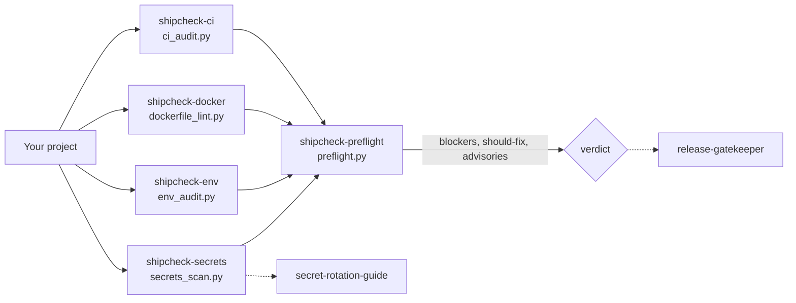

# ship-check-skill

**The 60-second pre-flight for anything you are about to ship.**


Every team has the same post-mortems. A key committed in a hurry and scraped within minutes. A
variable added to the code and never to `.env.example`, so the fresh deploy crashes. A
Dockerfile that runs as root and pipes `curl` into a shell. A workflow that pastes a pull
request title into a shell script. None of it is hard to catch. It is just never anyone's job
at 6 pm on a Friday.

This Claude Code pack is that job. Four small scripts check the working tree, the environment
contract, the Dockerfile and the GitHub Actions workflows. A fifth merges them into one page
with a verdict, and that verdict is computed: it will not say "ship it" while any
high-severity finding is open. Secrets are masked in every output, and when one has leaked the
advice is rotation first, history cleanup later.

Everything runs locally with the Python standard library. No network calls, no telemetry.

## What's inside

| Skill | What it does |
|---|---|
| [`shipcheck-secrets`](skills/shipcheck-secrets/SKILL.md) | `secrets_scan.py`: provider patterns, generic assignments and entropy, `.env` hygiene, optional git history. A rotation-first response, with per-provider pointers. |
| [`shipcheck-env`](skills/shipcheck-env/SKILL.md) | `env_audit.py`: env vars the code reads vs `.env.example`, docker-compose and CI. Writes a clean `.env.example`. Never prints a real `.env` value. |
| [`shipcheck-docker`](skills/shipcheck-docker/SKILL.md) | `dockerfile_lint.py`: 20 rules, multi-stage aware. Then a behaviour-preserving rewrite: multi-stage, non-root, cache-friendly. |
| [`shipcheck-ci`](skills/shipcheck-ci/SKILL.md) | `ci_audit.py`: GitHub Actions hardening with a hand-written YAML subset parser. Explains the attack behind each finding. |
| [`shipcheck-preflight`](skills/shipcheck-preflight/SKILL.md) | `preflight.py`: runs the four checks and prints one go or no-go report. |

| Agent | What it does |
|---|---|
| [`release-gatekeeper`](agents/release-gatekeeper.md) | Reads the reports and decides: NO-GO, INCOMPLETE, GO WITH CONDITIONS or GO, with reasons and a fix order. |
| [`secret-rotation-guide`](agents/secret-rotation-guide.md) | Given masked findings, lists rotation steps per provider in order, with blast-radius questions to ask first. |

## Install

```
/plugin marketplace add vivekbhange-hub/ship-check-skill
/plugin install ship-check-skill@ship-check-skill
```

Manual install: copy `skills/*` into `~/.claude/skills/` and `agents/*` into `~/.claude/agents/`.

Requirements: Python 3.9 or newer, and `git` if you want `--history` or tracked-file detection.

## Try it in 60 seconds

The repo ships a deliberately flawed app, [`examples/sample-app/`](examples/sample-app/): a
Dockerfile, a compose file, a `.env.example`, a workflow and three source files. The committed
tree holds no secrets. The fake credentials (an AWS key, a GitHub token, a Stripe key, a private
key, a database URL) are assembled at run time from fragments into a git-ignored folder:

```
python3 examples/regenerate.py --materialize
python3 skills/shipcheck-preflight/preflight.py .shipcheck-demo
```

On Windows use `python` instead of `python3`. Or just ask Claude Code: "run the pre-flight on
.shipcheck-demo". The scripts print only masked values. Real output, copied from the committed
files in [`examples/output/`](examples/output/):

```text
shipcheck secrets: scanned 13 files, 10 findings (7 high, 3 medium, 0 low, 0 info)
.env  SC021  medium  env-file-not-gitignored  [file]  fp:2a0d2d9716a1
.env:4  SC006  high    stripe-live-secret-key  sk_l****dc  fp:90d27b22a891
config/settings.py:2  SC001  high    aws-access-key-id  AKIA****3H  fp:3dd4f60d538c
config/settings.py:3  SC002  high    aws-secret-access-key  k3Jv****2q  fp:d2fce5eea898
deploy/id_rsa:1  SC009  high    private-key-block  [private key block]  fp:36c4285fda0d
scripts/notify.sh:2  SC003  high    github-token  ghp_****R8  fp:7b12fb344b38
```

Each line is a location, a rule id, a severity, the rule name, a masked value (first 4 and last
2 characters, or nothing for short values) and a fingerprint you can put in `.shipcheck-ignore`.
The Dockerfile lint ([`docker.md`](examples/output/docker.md)):

```text
shipcheck docker: 1 Dockerfile, 17 findings (2 high, 7 medium, 7 low, 1 info)
Dockerfile:3  DL010  high    ENV JWT_SECRET sets a secret-looking value in the image: supe****23
Dockerfile:9  DL005  high    downloads a script and pipes it straight into a shell
    fix: Download to a file, verify its checksum or signature, then run it.
Dockerfile:13  DL012  medium  EXPOSE 22: this image is set up to accept SSH
```

The workflow audit ([`ci.md`](examples/output/ci.md)):

```text
shipcheck ci: 1 workflow, 12 findings (5 high, 4 medium, 3 low, 0 info)
.github/workflows/deploy.yml:13  CI002  high    actions/checkout with ref: ${{ github.event.pull_request.head.sha }} under pull_request_target
.github/workflows/deploy.yml:14  CI001  high    uses: acme-corp/deploy-action@main (third-party) is pinned to a branch, not a commit SHA
.github/workflows/deploy.yml:24  CI004  high    untrusted value interpolated into a script: ${{ github.event.pull_request.title }}
```

The env audit ([`env.md`](examples/output/env.md)) reads a real `.env` by key name only:

```text
.env  ED007  medium  JWT_SECRET is empty in .env but the code needs a value
.env.example:5  ED004  high    SESSION_SECRET has a real-looking value in the example file: corr****le
.env.example:8  ED003  medium  PORT is defined twice in this example file (first on line 2)
src/client.js:2  ED005  high    VITE_ADMIN_SECRET will be exposed to browsers by its prefix
```

And the verdict ([`preflight.md`](examples/output/preflight.md)):

```text
Verdict: NO-GO. 16 blocker(s) are open; do not ship until each is fixed or explicitly accepted by the owner.

| Check | High | Medium | Low | Info | Status |
|---|---:|---:|---:|---:|---|
| secrets | 7 | 3 | 0 | 0 | ran |
| env | 2 | 7 | 5 | 0 | ran |
| docker | 2 | 7 | 7 | 1 | ran |
| ci | 5 | 4 | 3 | 0 | ran |
```

`python3 examples/regenerate.py --check` proves the committed outputs are exactly what the
scripts produce today.

## How it works



1. **Scan.** Each script emits findings with the same fields: file, line, rule id, severity,
   message and fix. `secrets_scan.py` uses `git ls-files` when the folder is a repo, skips
   binaries, lockfiles and vendor folders, ignores obvious placeholders (`changeme`,
   `your-api-key`, `<token>`, `${VAR}`) and the well-known documentation keys, and never prints
   a full value.
2. **Merge.** `preflight.py` groups findings into blockers (high), should-fix (medium) and
   advisories (low, info). The verdict is `NO-GO` with any high finding, `INCOMPLETE` if a check
   failed to run, `GO WITH CONDITIONS` with medium findings only, and `GO` otherwise. "Ship it"
   appears only under `GO`.
3. **Fix, in order.** Leaked credentials first and rotation before cleanup; then CI holes that
   let outsiders run code; then image and env problems; then the rest. Skills rewrite the
   Dockerfile and `.env.example` and harden workflows, and re-run the check to prove it.

Wire the same scripts into your own gates. They exit 1 when a finding at or above `--fail-on`
(default `high`) remains, 2 on usage errors:

```
python3 skills/shipcheck-secrets/secrets_scan.py . --fail-on high       # .git/hooks/pre-push
python3 skills/shipcheck-preflight/preflight.py . --fail-on medium      # CI job
```

Allow a confirmed false positive with `fp:<fingerprint>` or a path glob in `.shipcheck-ignore`,
or an inline `shipcheck:ignore` comment.

## Responsible use

This pack is for projects you own or are authorized to audit: your own repositories, your
employer's with permission, or a client's under an agreement.

- Do not point the secrets scan at repositories or histories you are not permitted to read, and
  do not use a found credential: report it to its owner.
- When you find a leak, rotate or revoke first. Rewriting git history does not un-leak a secret.
- The output is masked on purpose. Do not paste unmasked secrets into chat, tickets or commits.
- The agents and skills only read and report. They do not push, deploy or change repository
  settings.

## Principles and limits

- **A report, not a guarantee.** A clean run means these rules found nothing, not that the code
  is secure. Heuristics have false positives (generic and entropy rules most of all) and false
  negatives (secrets in formats it does not know, split across lines, or in binary files).
- **Rotation first.** Every skill that finds a secret treats it as burned.
- **Masked everywhere.** First 4 and last 2 characters at most. The real `.env` is reported by
  key name and emptiness only.
- **Honest about parsing.** `ci_audit.py` reads a YAML subset by hand: no anchors, aliases,
  tags, merge keys, multi-document files or multi-line plain scalars. A workflow it cannot read
  is reported as not audited (CI000) and the pre-flight lists it under "Not checked".
- **Static only.** The env audit sees literal variable names; dynamic reads are counted, not
  audited. The Docker lint never builds an image. Nothing checks runtime configuration that
  lives outside the repository.
- **GitHub Actions only** for CI. Other CI systems are not covered yet.
- **Nothing leaves your machine.** No network calls, no telemetry, no third-party packages.

## Contributing

See [CONTRIBUTING.md](CONTRIBUTING.md). Run the tests with
`python -m unittest discover -s tests -v`.

## Author

Built by [Vivek Bhange](https://vivekbhange.tech), Full-Stack AI Engineer.
See this project on my portfolio: https://vivekbhange.tech/projects/ship-check-skill/
More open-source skill packs: https://vivekbhange.tech/projects/

## License

MIT © 2026 Vivek Bhange. See [LICENSE](LICENSE).
